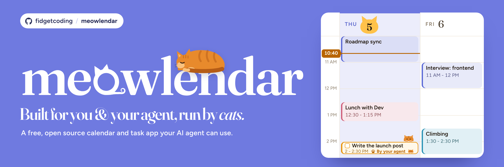

# Meowlendar

**Tasks and calendars in one place, unlimited calendars, a real API, and $0. Also there are cats.**

Tell your AI agent to put a task on Thursday at 2 and it lands on the grid, with no inbox and no dragging.

**Want the real story?** [ESSENCE.md](ESSENCE.md) is the one-pager. [EVOLUTION.md](EVOLUTION.md) has the best screw-up in the whole collection: 1,255 passing tests on an app where nothing worked.

## What it is

A calendar and task app you run yourself, with a REST API and an MCP server so your agent can do anything you can do. **I don't run a database for anyone, and there's no hosted Meowlendar.** You set up your own Supabase and it runs on your machine or wherever you put it. Your calendar stays yours, and I never see it.

Your coding agent can do almost all of the setup. There's a paste block below.

## Why I made it

I hate paying for tools. Motion called itself a smart calendar and had no usable API at the time, so my agents couldn't really touch it. Morgen was too expensive for what it was, and it was still missing things. Tasks made through its API landed in the inbox instead of on the calendar, which defeats the entire point.

I wanted tasks plus calendar, unlimited calendars, a link to my 2ndBrain, and a price of $0. Nobody sold that, because nobody can sell $0. So I made my own.

The name is for the brainrot and the meme value. It started as a poop-themed calendar called Poolendar, so really the cats are a step up. And I'm using it as the base for anything else I build that needs a calendar.

## Google sign-in and calendar sync

**Google is optional, but each self-hosted installation needs its own Google Cloud OAuth client** if you want the **Continue with Google** button or Google Calendar sync. The button is not configured by the default local setup; clicking it before setup returns a provider-not-enabled error. For a local calendar without Google, use **Sign up** with an email and password instead.

For Google, follow the complete [Google setup in DEPLOY.md](DEPLOY.md#2-google-cloud-setup):

1. Create or choose a Google Cloud project for your installation and enable the Google Calendar API.
2. Configure the OAuth consent screen. For an external app in testing, add each Google account you want to use as a test user.
3. Create a **Web application** OAuth client. For the default local setup, add `http://localhost:3000` as an authorized JavaScript origin and add both `http://127.0.0.1:54321/auth/v1/callback` and `http://localhost:3000/api/google/callback` as authorized redirect URIs. If your Supabase API uses a different port, use its actual API URL for the first callback.
4. Download the client JSON. Copy its client ID and secret into the following local files. Keep the secret out of chat, screenshots, logs and Git.

   Add to `apps/web/.env.local` without removing its existing values:

   ```dotenv
   GOOGLE_CLIENT_ID=your-client-id
   GOOGLE_CLIENT_SECRET=your-client-secret
   ```

   Create `supabase/.env` with the same values:

   ```dotenv
   SUPABASE_AUTH_EXTERNAL_GOOGLE_CLIENT_ID=your-client-id
   SUPABASE_AUTH_EXTERNAL_GOOGLE_SECRET=your-client-secret
   ```

   In `supabase/config.toml`, set `enabled = true` under `[auth.external.google]` for this installation. Don't commit that local configuration change or either environment file. Protect the secrets with `chmod 600 apps/web/.env.local supabase/.env`.

5. From the project root, stop the app, then restart the local Supabase project and app. **Don't use `--no-backup`:** it deletes the local database volumes.

   ```bash
   set -a
   . supabase/.env
   set +a
   supabase stop
   supabase start
   pnpm dev
   ```

   The Supabase CLI can print local service keys; don't share its output. If you use a nondefault Supabase project directory, run the commands against that project instead.
6. Open `http://localhost:3000` and choose **Continue with Google**. On first sign-in, Meowlendar takes you through calendar consent and starts the initial sync automatically. Approve the requested calendar access; Google may show an unverified-app warning while your app is in testing. To connect another account later, use **Settings > Calendars > Connect Google Account**. An email login works with local calendars and can connect Google later the same way.

Google's testing mode can expire calendar refresh tokens after seven days; DEPLOY.md explains the publishing and verification trade-offs. Hosted installations use their own domain and Supabase callback URLs.

## Set it up, the easy way

Paste this into Claude Code or whatever agent you use. It stops and asks when it needs you.

```text
Set up Meowlendar for me

Self-host Meowlendar on this machine from https://github.com/fidgetcoding/meowlendar. Follow DEPLOY.md in the repo if anything here is unclear. Work in this order and verify each step before moving on. Never print secrets, and never commit apps/web/.env.local or supabase/.env.

Names: the project used to be called Poolendar. @poolendar/* packages are correct. Do not rename them.

DO THESE YOURSELF

1. Check prerequisites: node -v (22 or newer), pnpm -v, supabase --version, docker info. If Docker is not running, start it (colima start, if colima is installed). If a tool is missing, tell me what to install and stop.

2. Clone the repo and run pnpm install.

3. Run pnpm setup:local.
   Verify: it exits 0 and apps/web/.env.local exists. If Supabase reports a container as "unhealthy", run it once more.

4. Start pnpm dev in the background.
   Verify: curl -s -o /dev/null -w "%{http_code}" http://localhost:3000/login prints 200.

5. Run pnpm --filter meowlendar-mcp build.
   Verify: packages/mcp/dist/index.js exists.

STOP AND ASK ME

6. Ask me to open http://localhost:3000, click Sign up, create an account, then go to Settings > API Keys, click Generate, and paste the pk_ key to you.
   Verify: curl -s -H "Authorization: Bearer <key>" http://localhost:3000/api/calendars returns JSON containing "local_calendars".

THEN WIRE THE MCP

7. Run, using the absolute path to the clone:
   claude mcp add meowlendar -s user --env MEOWLENDAR_API_KEY=<key> --env MEOWLENDAR_API_URL=http://localhost:3000 -- node <clone>/packages/mcp/dist/index.js
   Verify: claude mcp list shows meowlendar as Connected. A new session may be needed before its tools appear. Then call create_task with a title, scheduled_start, and scheduled_end, and confirm list_events for that day returns it with kind "task".

ASK ME BEFORE GOOGLE

8. Ask if I want Google sign-in or Google Calendar. If not, stop here. Everything works on the local calendar. The Google sign-in button does not work until the provider is configured.

   If yes, follow DEPLOY.md section 2 and walk me through the Google Cloud Console clicks one at a time. You cannot do them for me. Have me download the client JSON locally; read it without printing secrets, add the credentials as that section shows, and restart.

9. On first Google sign-in, follow the automatic calendar-consent flow and let me approve it. For additional accounts, ask me to use Settings > Calendars > Connect Google Account.
   Verify: the MCP list_calendars tool shows the accounts.

Finish by telling me which steps passed, which were skipped, and what is still running.
```

## Set it up by hand

1. **Install the tools:** Node 22+, pnpm, the Supabase CLI, and Docker Desktop or colima. Start Docker. `docker info` should print server details.
2. **Get the code:**
   ```bash
   git clone https://github.com/fidgetcoding/meowlendar && cd meowlendar && pnpm install
   ```
3. **Run `pnpm setup:local`.** Every line should start with `ok`, and it writes `apps/web/.env.local`.
4. **Run `pnpm dev`** and open http://localhost:3000. You should see the walking cats.
5. **Click Sign up** and use any email and password. No email gets sent locally. You land on the week view, with a local calendar ready.
6. **Connect your agent.**
   - `pnpm --filter meowlendar-mcp build`
   - In the app: **Settings > API Keys**, name a key, **Generate**, copy it. It's shown once.
   - Then, with your key and path:
     ```bash
     claude mcp add meowlendar -s user \
       --env MEOWLENDAR_API_KEY=pk_your_key \
       --env MEOWLENDAR_API_URL=http://localhost:3000 \
       -- node /absolute/path/to/meowlendar/packages/mcp/dist/index.js
     ```
   - `claude mcp list` should say Connected. Ask for a task with a start and end time, and watch it land.
7. **Add Google if you want it.** [DEPLOY.md](DEPLOY.md) has the clicks. The setup uses your own Google Cloud OAuth client; Continue with Google requests calendar access in the same consent and starts syncing automatically.
8. **Host it if you want.** DEPLOY.md covers hosted Supabase and Vercel, and I haven't run those yet either. Read [SECURITY.md](SECURITY.md) first.

Why do some internals say `poolendar`? That's the old name. Renaming the rest isn't worth breaking things, so it stays.

## What's in it

- **Week calendar grid:** create by double-click or drag, right-click menus, an edit form.
- **Tasks on the grid through the API.** That's the whole reason this exists.
- **Local calendars and recurring events.** No Google needed, and you can add as many as you want.
- **Kanban board:** four columns, drag cards around.
- **Routines, tags, subtasks, a command bar and keyboard control.**
- **Booking pages** at `/book/<slug>` or `you.example.com/<slug>`, with shared availability and approvals.
- **MCP server with 63 tools.** Everything your agent could want, over one API key. You build it from your clone for now.
- **2ndBrain link.** Two-way sync between Obsidian Tasks lines and your tasks, as a `meowlendar-vault` CLI and three MCP tools. It always shows a dry run first and backs up before it writes. [Details](packages/mcp/README.md#2ndbrain-link).
- **Reminders** by push, email and Telegram.
- **Google Calendar sync,** automatic and both ways, across any number of accounts, with a picker per calendar and optional task mirroring.
- **Cats.**

## How I test it

The November 4 maintenance pass verified 1,643 unit tests, 24 browser checks, and 150 integration tests against a fresh local Supabase and a production build. Google, Telegram, Resend and push were local fakes in those automated runs. On November 5, a real Google account was connected to a local installation and its calendars and events were pulled successfully; real Google writes and other providers were not part of that check. Browser tests run headless and silent. Existing installations need to apply the new migrations safely; see [DEPLOY.md](DEPLOY.md).

## License

[MIT](LICENSE). Built by Nate Davidovich. Take it. Build your own calendar on top of it. That's what I'm doing.
